# Building the Monitoring Plane: Server, Zero-Trust Access, and First Agent

*Phases 0 through 2 of my Wazuh SIEM home-lab series. How the lab itself got built, before any detection work started.*

**Focus:** Blue-team infrastructure / detection engineering groundwork
**SIEM:** Wazuh 4.14.6 (all-in-one) · **Manager host:** Ubuntu 22.04 on bare metal · **First endpoint:** macOS (Apple silicon)

---

## Objective

Before I could detect anything, I needed a place for detections to live. These three phases are the unglamorous part: stand up a Wazuh manager on real hardware, make it reachable without exposing it to the public internet, and enroll the first endpoint so there is actually something to monitor. I wanted every piece of this to be deliberate, not a copy-paste install, because the choices I make here decide what the rest of the lab can and cannot see.

## Why this matters

A SIEM is only as good as the plane it runs on. If the manager is exposed to the internet, I have built an attacker's target instead of a defender's tool. If the agent cannot reach the manager, I get silence that looks exactly like "no threats." And if I cannot tell my own infrastructure failures apart from real detections, I cannot trust a single alert the lab produces. So the goal across these phases was a reachable, hardened monitoring plane with no public exposure, and a first agent reporting in cleanly.

## Lab setup

- **Manager:** Wazuh all-in-one 4.14.6 on Ubuntu Server 22.04, running on a repurposed 2015 MacBook Air.
- **First endpoint:** a macOS laptop (Apple silicon) enrolled as an agent, used later as the victim host.
- **Management plane:** a Tailscale mesh, so the dashboard and SSH stay reachable from my other machines without opening a single port to the internet.
- Sensitive values (usernames, hostnames, IP addresses, email) are redacted throughout these screenshots. Rule IDs, versions, timestamps, and command output are left intact as evidence.

---

## Phase 0: Standing up the server

I did the base install on bare metal rather than a VM, because I wanted the lab to survive reboots and power events on its own hardware and to feel like a real deployment. The Ubuntu Server install finished clean.

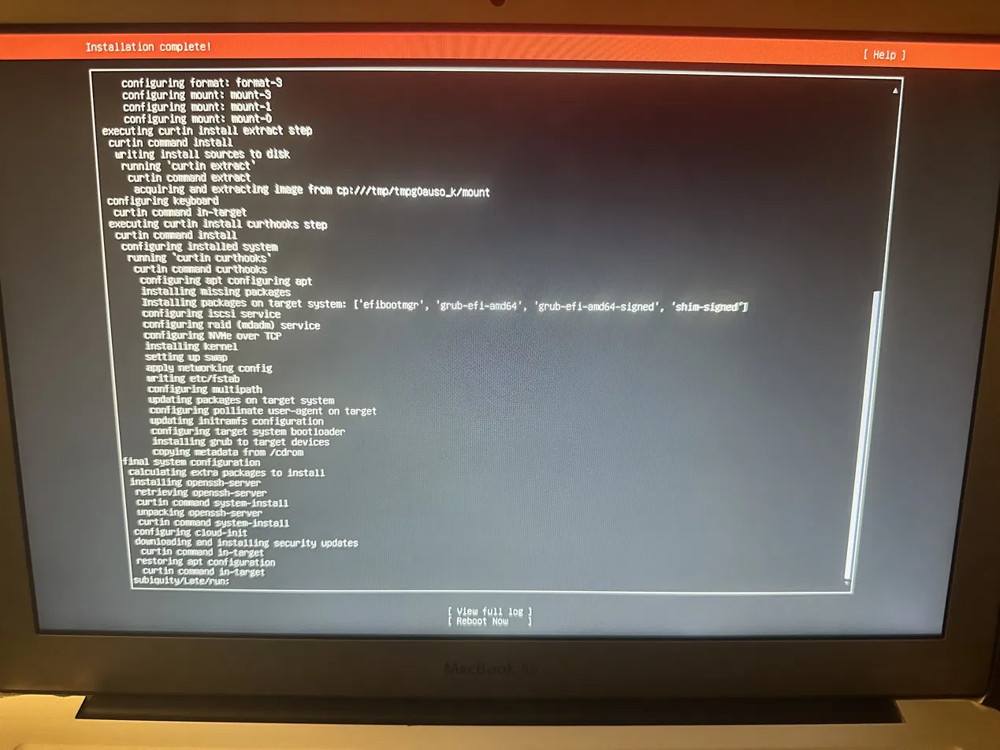

*Base OS installed on bare metal. This is the manager host before anything else goes on it.*

First boot, patched, and on the network.

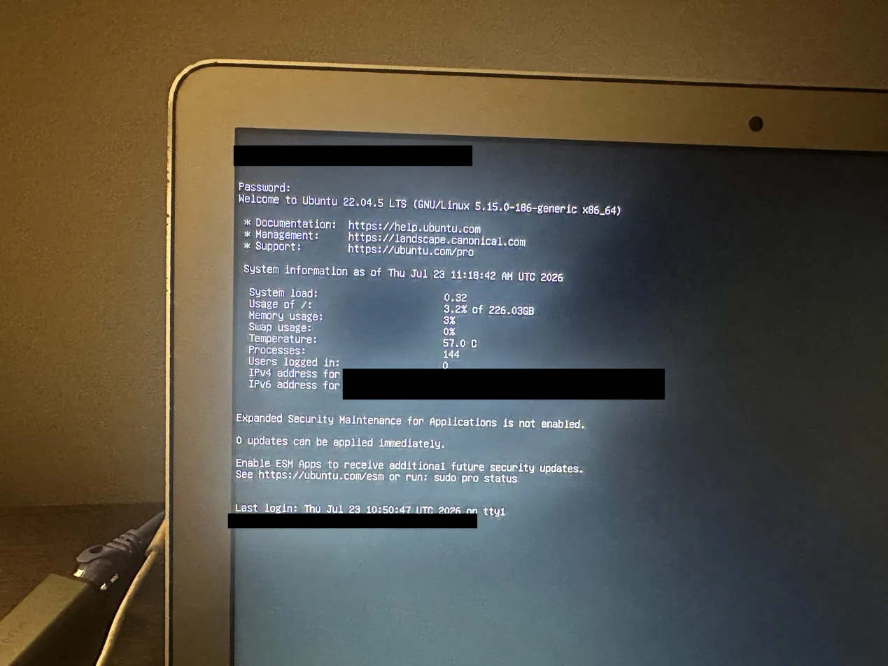

*First boot. Addressing and interface details are redacted, but this is the host coming up on the LAN for the first time.*

Then the Wazuh all-in-one install, and the check that actually matters: are all four services up. Indexer, manager, dashboard, and filebeat all report active.

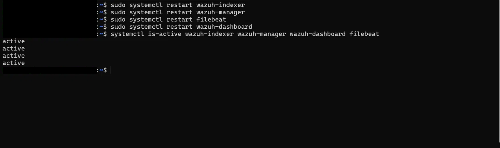

*The four core services after install. If any one of these is down, the pipeline is broken, so this is the first thing I verify and the first thing I check whenever the lab acts up.*

With the stack running, the dashboard comes up. At this point there are no agents yet, which is exactly what I expect.

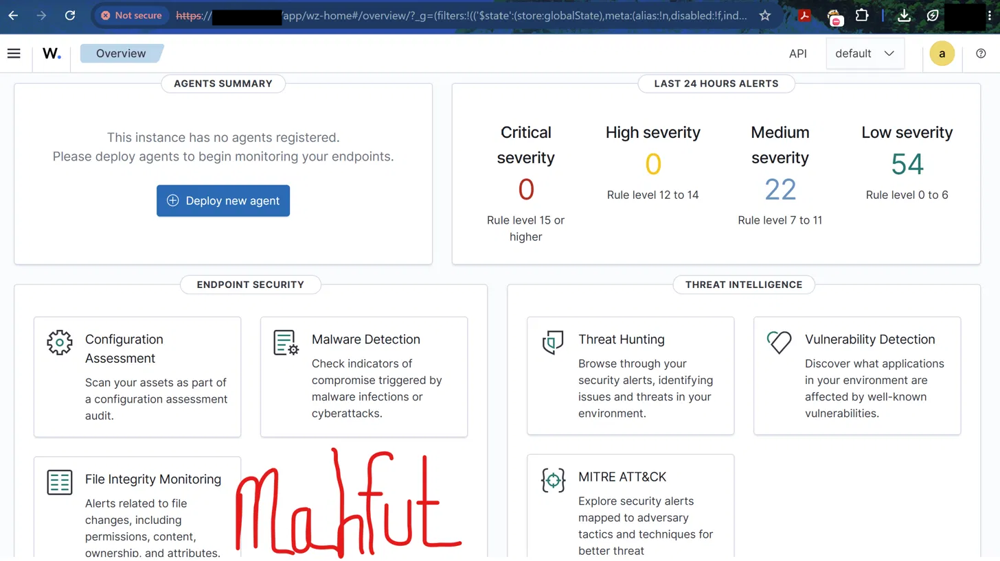

*Dashboard live and reachable. "No agents registered" is the correct state for end of Phase 0. There is nothing to monitor yet, and that is the point.*

## Phase 1: A zero-trust management plane

I did not want this dashboard or SSH reachable from the public internet. The clean way to get remote access without port-forwarding is an overlay network, so I put the manager and my other machines on a Tailscale mesh. Everything management-related rides over that private tailnet.

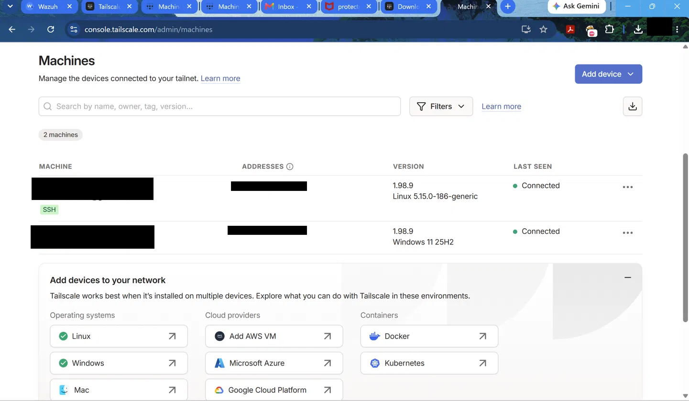

*The management plane. The manager and my admin machine join a private mesh. Nothing here is exposed to the internet, and there are no inbound ports open on the router for any of it.*

The proof that it works is boring, which is how you want infrastructure to be. I can SSH to the manager over the tailnet from another machine.

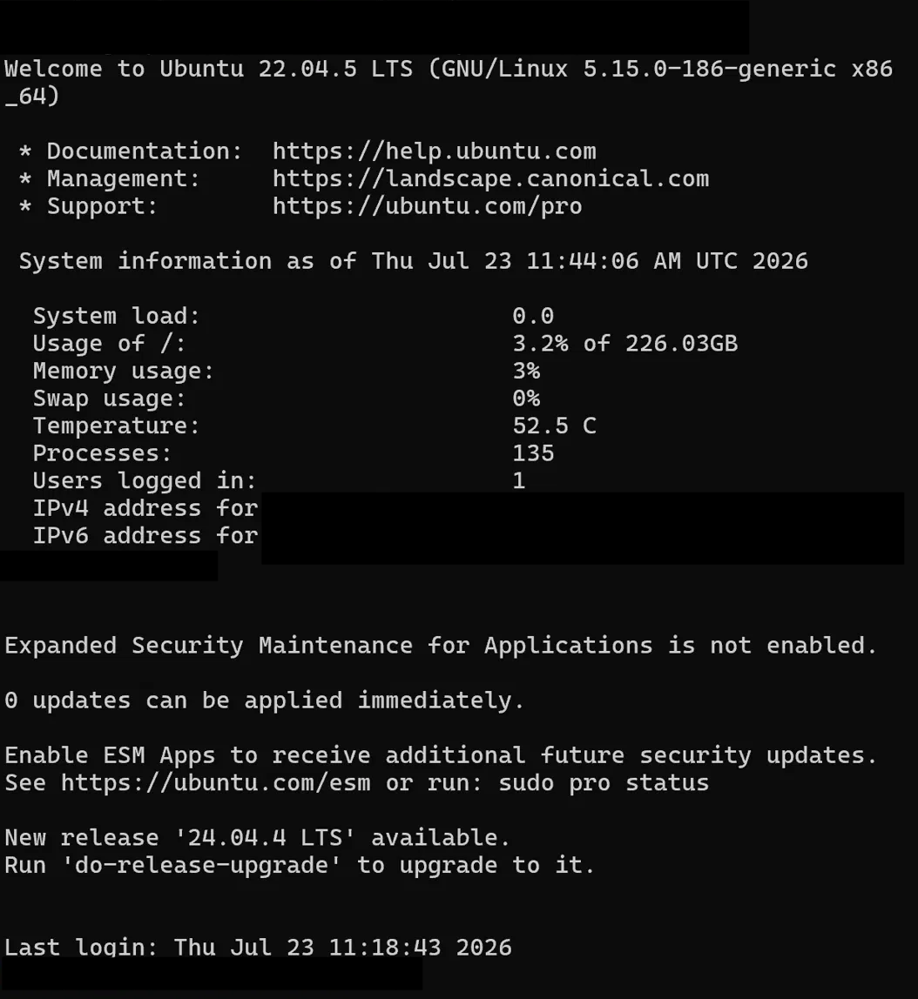

*Remote admin access over the private mesh. Addresses are redacted, but this is a full login to the manager without touching the public internet.*

And it holds up off my home network too. I pinged the manager's tailnet address from a completely different network and got clean replies, which means my management plane follows me instead of being tied to one LAN.

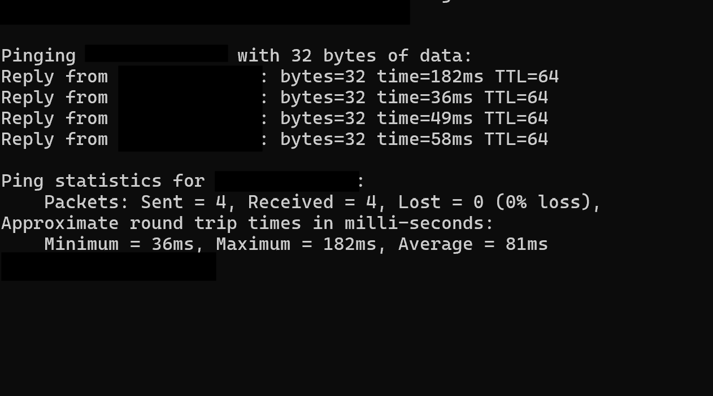

*Reachability from off-site. Zero loss to the manager over the mesh from a different network. The management plane is portable, the attack surface is not.*

## Phase 2: Enrolling the first agent

Now there is a manager with nothing to watch, so I enrolled the macOS laptop as the first agent. The endpoint joins the same tailnet first, so agent-to-manager traffic also stays on the private mesh.

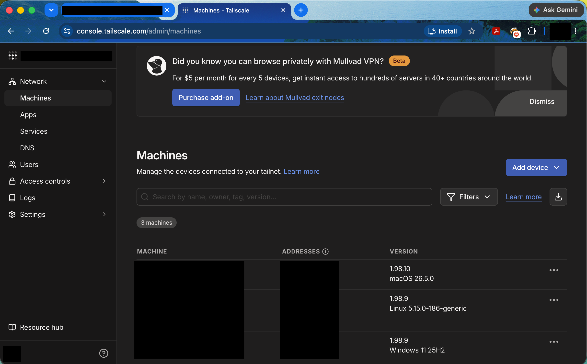

*The macOS endpoint joins the tailnet before enrollment, so its agent traffic to the manager never leaves the private mesh.*

Starting state on the manager, confirmed from the dashboard: still no agents.

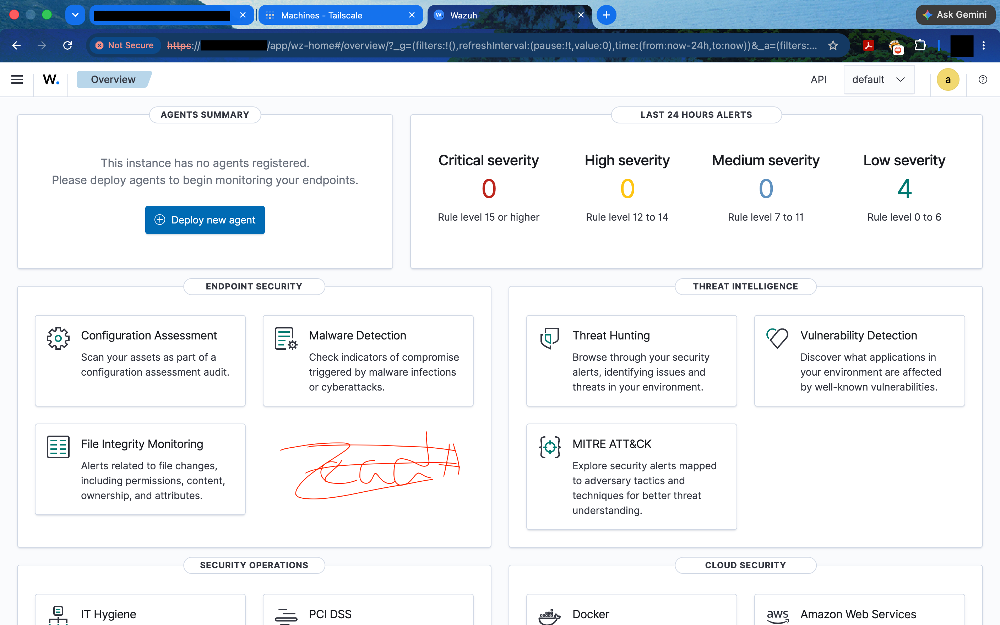

*Before state. Zero agents. This is the baseline I am about to change.*

### A mistake worth keeping

My first instinct was wrong, and I am leaving it in because the lesson is the valuable part. I tried to install the Wazuh *agent* package on the manager host itself. The package manager stopped me cold.

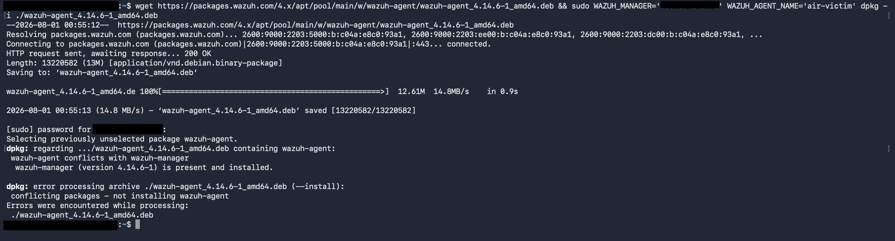

*The agent and manager packages conflict on the same host, and dpkg refuses the install. The manager is not an endpoint you enroll against itself. The right move is to enroll a separate machine, which is what I did next.*

### Deploying to the Mac

The dashboard's deploy wizard builds the enrollment command for you. I selected the macOS Apple-silicon package and pointed the agent at the manager's tailnet address.

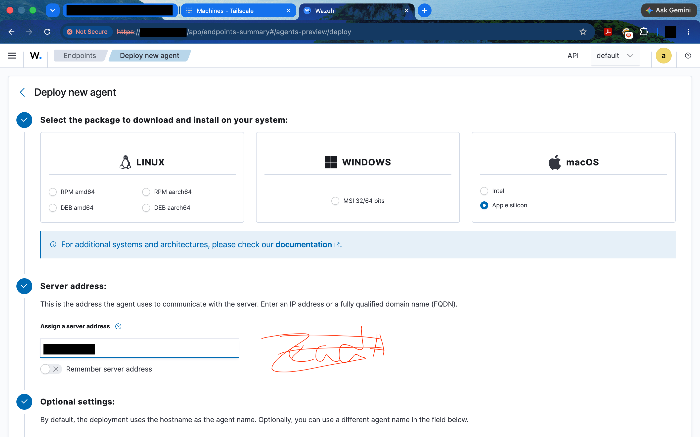

*The deploy wizard. Package selected, server address set to the manager's tailnet IP (redacted). The agent will talk to the manager over the mesh.*

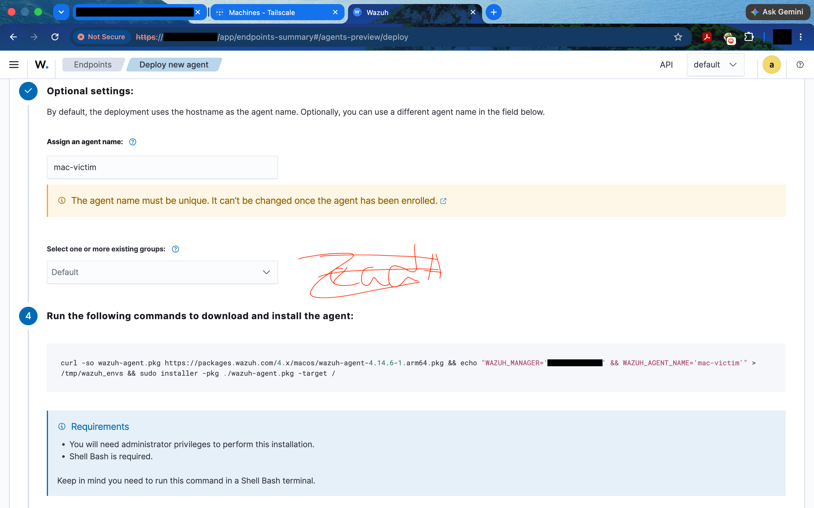

*The generated one-liner. It carries the manager address and the agent name. This uses the manager's auto-enrollment, so no key is ever pasted by hand.*

### A second mistake, same honesty

I ran the macOS install command on the wrong box first. On the Linux manager, `installer` is not a thing, so it failed immediately. Small error, but it is the kind that wastes an hour if you do not read the message.

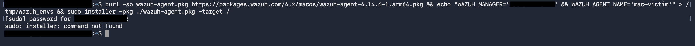

*Ran the macOS command on the Linux host by mistake. The error is the tell: `installer` is a macOS binary. Right command, wrong machine.*

On the actual Mac, the install goes through, the agent config points at the manager, and the services start.

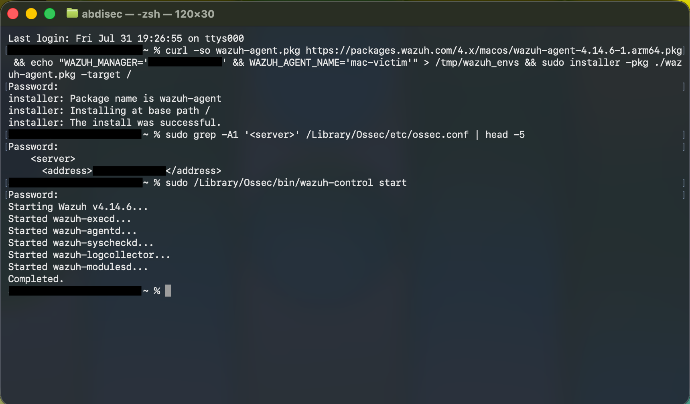

*On the correct host this time. The install succeeds, the agent config points at the manager (address redacted), and all agent daemons start.*

The agent's own log confirms it is not just running, it is working: it reloads config from the manager and kicks off a Security Configuration Assessment scan against a macOS CIS policy.

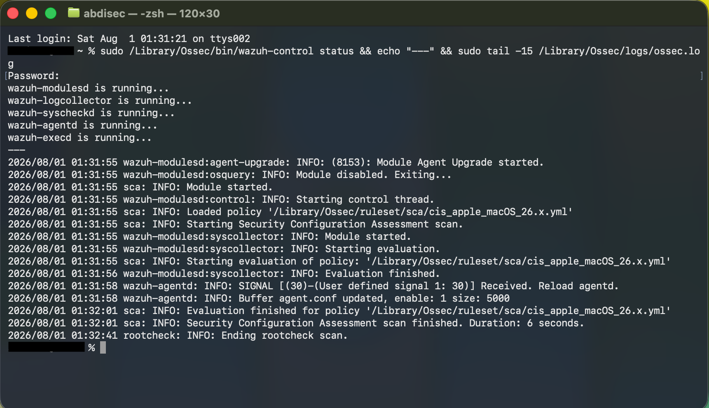

*The agent is live and already doing work. It pulled shared config from the manager and ran a CIS scan on the endpoint. This is a two-way connection, not just a process that started.*

And the payoff, back on the manager's dashboard: one active agent.

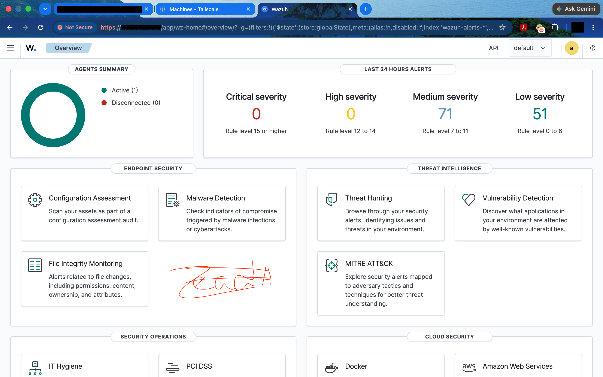

*After state. One agent, active, with alerts already flowing. The monitoring plane now has something to monitor.*

## What I ended up with

A Wazuh manager on real hardware, reachable only over a private mesh, with the first endpoint enrolled and reporting. No public exposure, no port-forwarding, and a clean before-and-after that proves the agent went from zero to active. From here, the lab has an endpoint to attack and a manager to catch it, which is everything the detection phases need.

## Key lessons

1. Build the plane before the detections. An exposed or unreachable manager invalidates every alert that comes after it.
2. The manager is not its own agent. The package conflict is the system telling you to enroll a separate host.
3. Read the error, check the host. "command not found" was not a broken install, it was the right command on the wrong machine.
4. Verify two ways. A service that started is not the same as an agent that is enrolled and scanning. The dashboard and the agent log have to agree.
5. Keep the mistakes in. The conflict and the wrong-host error are not embarrassing, they are the part of the writeup that proves I actually did this and worked through it.
