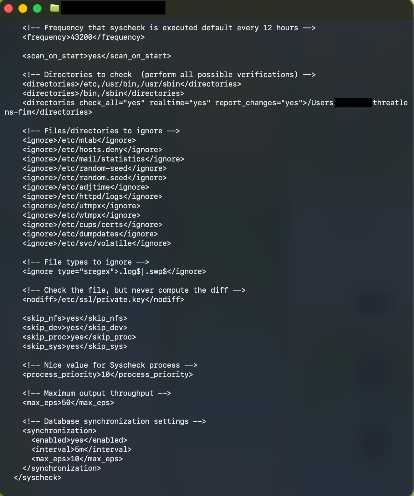
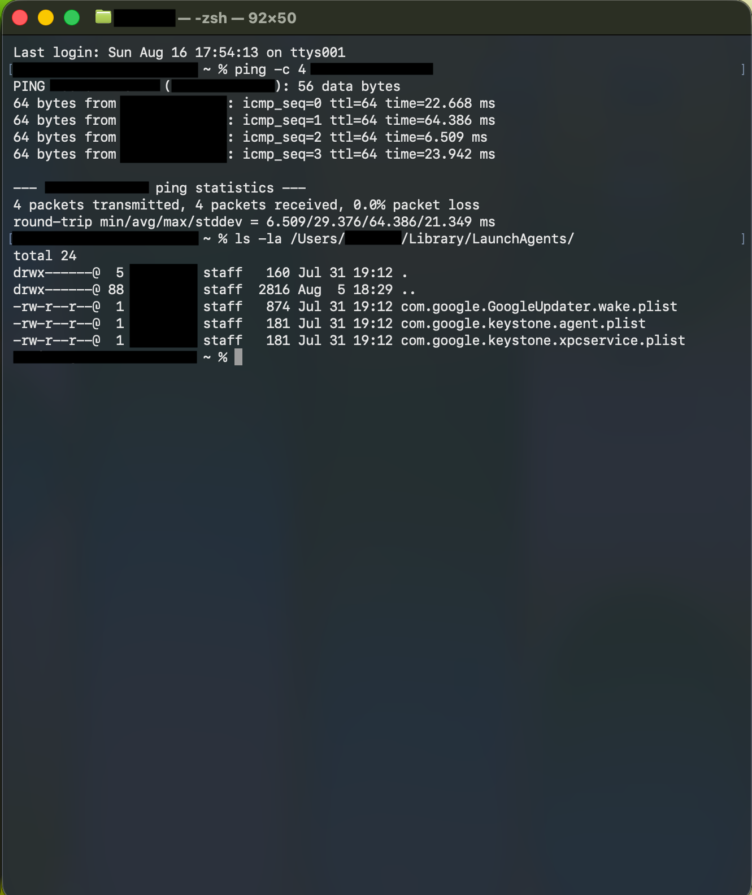
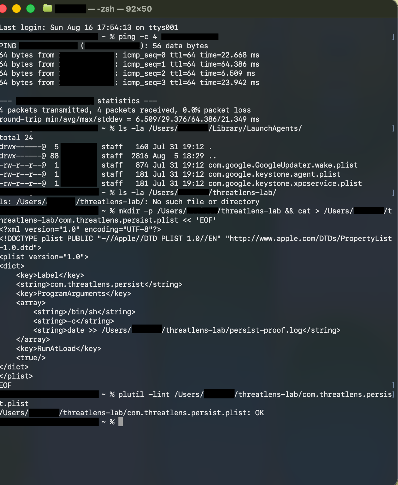
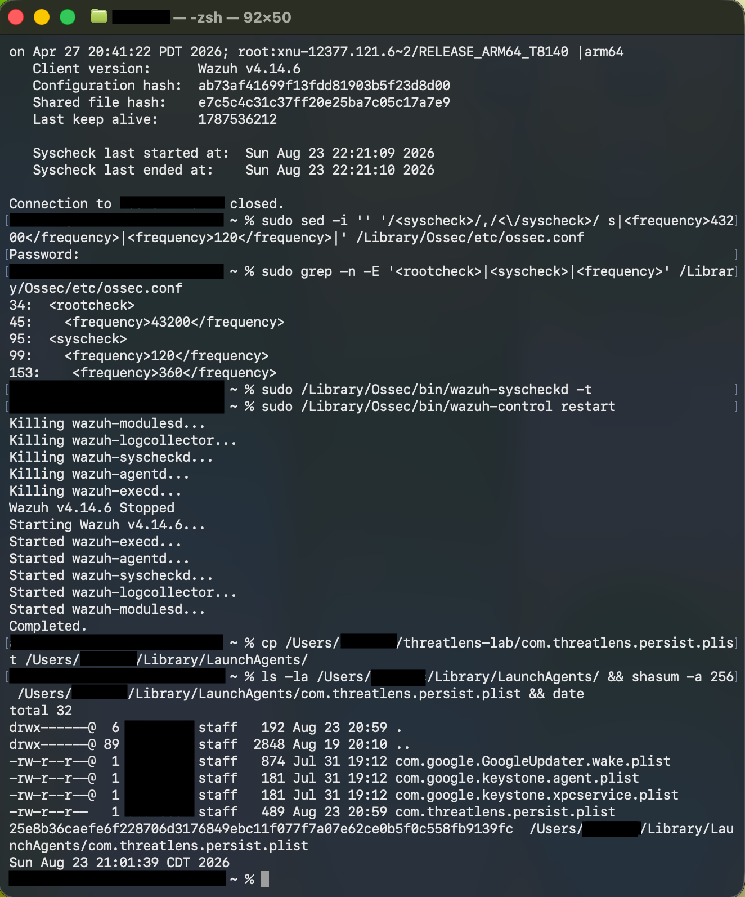
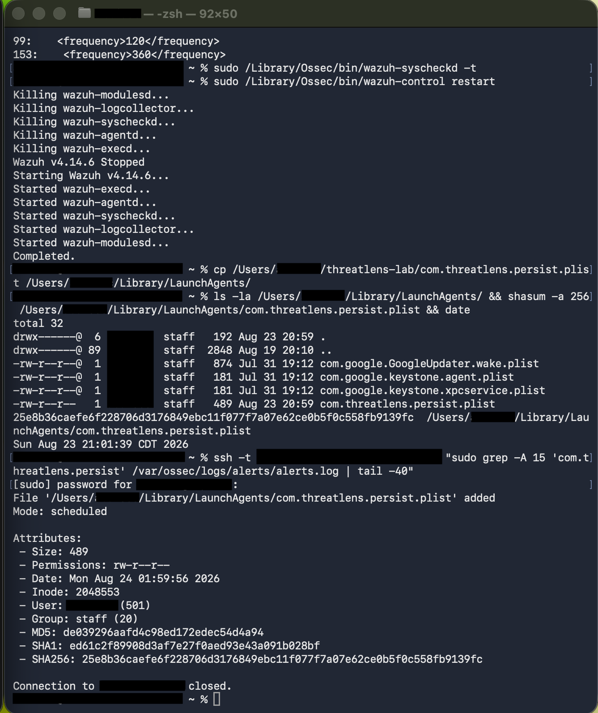

# macOS LaunchAgent Persistence: Detecting It with Wazuh FIM

*Phase 5 of my Wazuh SIEM home-lab series. A blue-team detection walkthrough.*

**MITRE ATT&CK:** T1543.001 (Create or Modify System Process: Launch Agent)
**Focus:** Detection engineering / blue team
**SIEM:** Wazuh 4.14.6 (all-in-one) · **Endpoint:** macOS (enrolled Wazuh agent)

---

## Objective

I wanted to find out whether Wazuh File Integrity Monitoring (FIM) can actually catch a LaunchAgent persistence attempt on macOS. More specifically: if I drop a new `.plist` into a user's `~/Library/LaunchAgents` directory, does Wazuh raise a file-added alert (rule 554) that makes it all the way to the manager, and does it do that cleanly without burying the signal under false positives from legitimate agents?

## Why this matters

LaunchAgents are one of the most common ways attackers persist on macOS. A `.plist` with `RunAtLoad` set to `true` runs its payload every time the user logs in. It survives reboots, and it doesn't need admin rights, because the user already owns `~/Library/LaunchAgents`. From a SOC point of view, "a new LaunchAgent just showed up" is a high-value, low-noise signal. It's exactly the kind of thing FIM should be catching.

## How the technique works

It's simple, which is part of why it's popular:

1. The attacker writes a `.plist` into `~/Library/LaunchAgents` pointing at their payload, usually with `RunAtLoad` (and sometimes `KeepAlive`) turned on.
2. Next time the user logs in, the payload runs. That's persistence.
3. No `sudo` required, since the per-user directory is user-owned. Quiet and convenient.

## Lab setup

- **Manager:** Wazuh all-in-one 4.14.6 on Ubuntu 22.04, running on bare metal.
- **Endpoint:** a macOS host with an enrolled Wazuh agent, playing the victim.
- **FIM config:** syscheck watching `~/Library/LaunchAgents`.
- Management happens over a private overlay network (specifics left out on purpose).

One important platform quirk up front: macOS does not honor Wazuh's realtime syscheck flag. The agent logs a realtime-unsupported warning when you try. So everything here relies on **scheduled** scans, not realtime. That detail ends up mattering a lot.

*The agent syscheck config, with the user LaunchAgents directory added to the monitored set. Sensitive values (username, host, addresses) are redacted throughout these screenshots; rule IDs, hashes, and ATT&CK details are left intact as evidence.*

## Hypothesis

If I create a new `.plist` in the monitored directory, the next scheduled scan should fire syscheck rule 554 (file added), and the alert should carry enough metadata (hashes, owner, permissions) to prove exactly what landed on disk.

## Control group

Before touching anything, I catalogued what was already in the directory: three legitimate Google updater plists, all owned by the user, matching timestamps, triaged as benign. These became my "must not fire" baseline. If my detection is clean, these stay silent for the whole test. If they light up, my signal is noisy and I have a problem.

*The baseline: three legitimate Google updater plists already in the directory. This is the control group that has to stay silent for the detection to count as clean.*

## Running the attack

I dropped a deliberately harmless proof-of-concept payload into the monitored directory:

- `RunAtLoad = true`
- The payload just appends a timestamp to a local log file. It proves execution without doing anything destructive.
- Validated it with `plutil -lint` before deploying.
- No `sudo`, since the user owns the directory. Same as the real technique.

*The benign payload staged and validated with `plutil -lint` before deployment. RunAtLoad is set to true, and the payload only writes a timestamp to a local log.*

*The payload dropped into LaunchAgents, with its SHA256 captured straight from the filesystem. This hash is one half of the chain of evidence. The other half comes from the manager alert below.*

## A pre-flight check that saved the result

An earlier attempt at this test got aborted, and I'm glad it did. A quick pre-flight check caught the Wazuh manager silently offline. If I'd gone ahead, the 554 alert would have had nowhere to go, and I'd have written down "macOS doesn't detect creation," which would have been completely wrong.

Lesson I took from that: confirm the pipeline is actually alive before you trust a negative result. A dead collector looks exactly like "nothing detected." Every test I run now starts with a manager liveness check.

## The result

Inside the scheduled-scan window, the manager logged the alert:

- Rule 554 ("File added to the system")
- Mode: scheduled
- Full metadata: size, permissions, inode, owner (user and group), and MD5 / SHA1 / SHA256

The SHA256 in the alert matched the hash of the file on disk exactly. That closes the chain of evidence: the thing the SIEM flagged is provably the thing I dropped, not a guess.

*The manager's rule 554 alert: file added, Mode scheduled, full metadata, and a SHA256 that matches the filesystem capture above exactly. That match is the chain of evidence closed.*

And the three legitimate plists? They stayed quiet. One clean addition, zero false positives.

## What I found

macOS Wazuh syscheck detects file creation (rule 554) through a scheduled scan. But in the exact same setup, it does not detect file modification (rule 550), which I'd established in the previous phase. Creation and modification run through different syscheck code paths, and on this macOS agent, creation gets caught while modification slips through.

So here's the defender takeaway: for macOS LaunchAgent persistence (T1543.001), Wazuh FIM is a solid detection for a freshly planted plist, but you can't lean on it to catch someone tampering with an existing one. Treat "new LaunchAgent" as covered, and treat "modified LaunchAgent" as a blind spot you need to close another way.

## Cleanup

- Ran `launchctl unload` and removed the test plist, then confirmed only the legitimate plists were left. No persistence remaining on the endpoint.
- Put the syscheck scan frequency back to its production value.
- Left `~/Library/LaunchAgents` under monitoring, so the detection coverage stays in place.

## MITRE ATT&CK mapping

| Field | Value |
|---|---|
| Tactic | Persistence (TA0003) |
| Technique | T1543.001 (Create or Modify System Process: Launch Agent) |
| Detection | Wazuh syscheck rule 554 (file added), scheduled scan |

## What I'd build next

- A custom detection rule to turn the generic 554 into a prioritized, ATT&CK-mapped LaunchAgent-persistence alert. Raw 554 fires on any new plist, including the benign ones, at a low severity. Detection engineering is what turns that into a tiered, actionable alert.
- Closing the modification blind spot, for example Windows FIM through a different code path, or who-data actor attribution to answer "who changed it."

## Key lessons

1. Always run a control group. "The alert fired" doesn't mean much until the benign baseline stays silent.
2. Prove the chain of evidence. Match the alert's hash to the file on disk instead of assuming they're the same.
3. Validate the pipeline before you trust a negative. A dead manager looks identical to "no detection."
4. Know your platform's quirks. macOS ignores realtime FIM, and creation and modification are not the same detection path.
